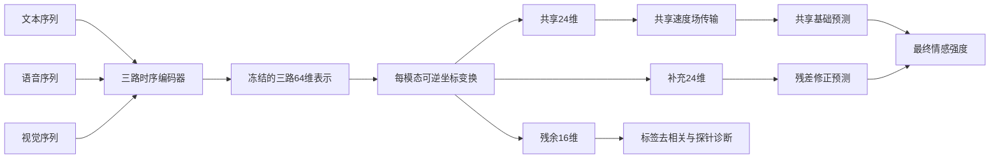

# 可逆信息分配与选择性共享流：第二版实验

本版研究的是：在固定的时序表示里，能否把可用于情感预测的信息保留到共享和补充分支，使其余分支的标签可读性下降，同时维持预测性能。三个分支的语义需要通过诊断检验，单凭结构和名称不能成立。

“共享”“冗余”和“噪声”需要区分：同一个情感线索在多个模态中重复出现，既可能是共享信息，也可能是有用的冗余证据。因此本版把第三支称为**残余坐标**，其目标是减少标签信息；不能宣称所有冗余都应该删除。补充分支则以共享预测未解释的标签残差为训练目标。

## 信息流



第一阶段训练三路双向 GRU 和拼接预测头，每路输入序列经训练集统计量标准化，有效帧按原顺序送入 GRU。主预测损失为 MSE，另有权重 0.05 的单模态辅助预测。用验证集 MAE 早停后，编码器进入 eval 模式并冻结。第二阶段的所有对照共享同一个种子的固定编码结果，因此标签去相关的梯度不能再改变编码器。

第二阶段对每个模态的 64 维固定表示做四层 affine coupling 变换，得到 24 维共享、24 维补充、16 维残余坐标。耦合层满足解析逆变换；其数值回环误差会在实际测试表示上记录。**可逆性只覆盖这段 64 维坐标变换**，原始序列到 GRU 表示的压缩不受该保证保护。

共享坐标另经四步 Euler 积分的速度场传输，训练目标是从每路共享向量到同一样本三路均值的线性桥接速度。目标和起点在速度匹配项中停止梯度；最终预测仍对传输路径反向传播。另加入权重 0.01 的近似反向积分回环损失。这段数值积分不具有坐标变换的解析可逆性保证。

共享分支的平均向量产生基础预测，补充坐标和三对逐元素交互产生修正预测。基础预测有额外权重 0.5 的标签损失，修正预测有权重 0.25 的残差目标 `y - stop_gradient(base)`。共享预测因此有独立的学习目标，补充分支被引导去解释剩余误差。残差训练仍不能保证它捕获严格意义上的独有信息或协同信息。

残余分支的每个坐标与标签的标准化批内相关系数平方被惩罚，权重在前五轮逐步增加至指定值。残余坐标另有标准差下界的软惩罚，避免只靠缩小输出幅度逃避约束；共享和补充坐标有弱交叉相关惩罚。这些都是可检验的训练偏好，不是信息独立性的证明。

## 对照与选择规则

同一随机种子的时序编码器用于三个第二阶段对照：固定表示直接拼接、可逆分解但无共享传输、可逆分解并加共享传输。无传输／有传输两种模型的共同模块初始化和每轮样本顺序保持一致。可逆模型增加了参数量，所以与拼接的差异不能全部归因于信息分解；匹配的无流／有流对照更适合判断共享传输的作用。

运行三个种子 0、1、2，各阶段最多 60 轮，验证集 MAE 连续 12 轮未改善时早停。去相关候选权重固定为 `0、0.5、2`。候选完成后，以如下预先写入代码的验证集分数选择一个共同权重供两种可逆模型使用：

`score = mean(valid_MAE + 0.05 * max(valid_nuisance_ridge_R², 0))`

平均覆盖三个种子和无流／有流两种模型。分数兼顾预测和标签泄漏，只用于本轮探索，系数 0.05 没有被解释为通用最优值。训练命令只加载 train/valid；选择结果写入 `selection.json` 后，测试评估由另一个命令启动，并记录该选择文件的哈希。

## 诊断

测试结果包含预测 MAE、按零阈值定义的 Acc2、Pearson 相关；共享支单独预测 MAE；各分支的岭回归标签探针；共享加补充坐标的联合探针；残余分支的非线性 MLP 标签探针；实际表示上的可逆回环最大误差和残余坐标平均标准差。岭回归的正则强度从 `1、10、100` 中用验证集选择，MLP 探针用验证集 MAE 早停。

同一 MLP 探针架构也在共享分支上训练作为正对照，避免把探针自身未学好误判为残余分支没有情感信息。

主评估完成后，`diagnose_geometry.py` 会只用已选模型的表示检查共享传输前后的配对 MSE、相对移动幅度和数值反向积分误差。它不使用测试标签、不重新选择模型。该检查用于区分速度场没有真正改变表示和改变了表示却没有稳定缩小这项差异两种情况。

另记录随机打乱补充坐标后的 MAE，观察修正是否依赖同一样本的补充信息。这是偏离训练分布的诊断，不能替代重新训练消融。低线性探针 R² 只说明当前探针读不出标签；非线性探针也弱时，仍不能直接证明完整的统计独立性。

输入是 MMSA 的官方 MOSI 划分与特征，保留三路输入和时序。数据文件中 train 和 test 各有一段视觉特征全零，编码器会把该路表示置零。主结果沿用官方全部样本，完整非空样本的指标另行记录。MOSI 是情感强度预测，后续仍需在离散情绪识别数据上验证。

第一版 MOSI 测试结果已经见过，因此第二版仍是事后探索。将选择和测试命令分开可以减少本轮继续试探测试集的机会，但不能把已有测试集重新变成独立确认数据。

## 运行与来源

```bash
python preprocess_sequence.py /path/to/aligned_50.pkl /path/to/mosi_sequence.npz
python train_v2.py --stage check
python train_v2.py --stage train --data /path/to/mosi_sequence.npz --out v2_run
python train_v2.py --stage evaluate --data /path/to/mosi_sequence.npz --out v2_run
python diagnose_geometry.py --data /path/to/mosi_sequence.npz --out v2_run
python summarize_v2.py v2_run --plot
```

原始 pickle 哈希见 README。当前序列 NPZ 的 SHA-256 为 `1c4cd4e3fc01818c173743e6484818d28e563b0298bb2eba5bc0cb6d4dfeec36`。模型检查点保存在远程 `/data/coding/selective_flow/v2_run`。

可逆耦合层的数学形式来自 [Real NVP](https://arxiv.org/abs/1605.08803)；共享／特有表示的历史基础可参考 [MISA](https://arxiv.org/abs/2005.03545)；模态速度场传输与循环保持的研究背景可参考 [CaReFlow](https://arxiv.org/html/2602.19140)。本版采用这些思想构建诊断原型，当前组合尚未经过充分的文献排重或独立数据验证。

继续检索发现两项直接相关工作：[MInD](https://arxiv.org/abs/2401.11818) 已结合共享／私有分解与对抗式无信息噪声建模；[SPriG 的期刊摘要](https://www.sciencedirect.com/science/article/pii/S1566253526004835) 已描述共享基础预测和按增益控制的私有残差。因此，“三分支”或“私有残差补充共享预测”本身不能作为本项目的独立创新点。SPriG 页面卷期标为 2027，本轮检索返回其摘要，全文访问受限，首次上线时间尚未核实。当前值得进一步检验的差异是：固定信息入口下，通过可逆坐标变换重新分配情感证据，再只对共享证据传输，并直接报告分支标签泄漏与预测代价。这仍是待验证的研究假设。
