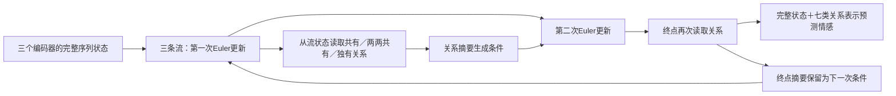

# 我们的第五轮实验：完整序列流中的关系读取与循环反馈

## 当前状态

两个版本均完成seed128、100轮训练，最佳检查点及预测结果已取回并通过独立核验。single测试MAE **0.6218**、去零Acc2 **88.40%**；cycle为 **0.6411／87.79%**。循环整体机制本轮没有优于single，单种子结果尚不能证明稳定优劣。

完整结果、纯文本对照与编码器审计见[结果汇总](结果汇总.md)。音视频辅助头接近常量预测；第六轮已在单独目录 `../own_flow_v6` 修复显式mask与固定训练归一化，并配套三组对照。第五轮训练源码与检查点保持原样。

本轮远程目录：`/data/coding/selective_flow/strong_baselines/own_flow_v5`。实时状态见 `status.json` 和各模型的 `history.json`。本地快照不代表实时进度。

此前我们自己的V4在冻结的预提取文本特征、5／20维音视频输入下，三种子MAE约0.9775±0.0125。本轮使用与官方CaReFlow复现相同的DeBERTa-v3-base微调、74／47维音视频及1281／229／685数据划分。跨轮改善不能直接归因于新增结构。

同条件首轮参考结果：CaReFlow含零MAE0.6450，去零Acc2为87.18%；无流直接融合含零MAE0.6462，去零Acc2为87.94%；纯文本为0.6411／87.79%。均仅seed128。

## 1. 三个模态先进入完整流

保留各单模态编码器的词级序列输出，而不是先平均池化后硬切语义坐标。文本、音频、视觉状态分别为50×100维（包含作者的padding设置），形成三条完整状态流。所有100维坐标都由对应模态的速度场更新，没有预设“前24维共享”等分区。

三条速度场分别读取当前完整状态、100维正弦时间嵌入与100维反馈条件；MLP为300→100→100，输出经tanh限幅为0.5。初始末层权重很小，使初始流接近恒等变换。每次完整前向使用两步Euler，时间0和0.5，步长0.5。

第二次完整前向重新从同一原始状态X开始，携带第一轮得到的条件；不会把第一轮终点误当作新的原始输入。两轮复用所有速度场、查询、反馈和预测头。

## 2. 信息关系在流中读取

每次Euler更新后，共享的8个可学习查询从三路完整序列中读取8个100维槽位。查询键去除本样本序列均值，再做LayerNorm与归一化；值保留完整状态。读取器使用token mask屏蔽padding，而编码器与整体平均池化仍沿用作者设置。

对槽位去均值后计算三对跨模态余弦，转换为软关系评分：

`q_mn = sigmoid((cosine_mn - 0.3) / 0.2)`。

每个模态的槽位按三路共有G、与另外两路的两种配对P、本路特有U软分配。对于a=q_mn、b=q_mp、d=q_np：

- G：a×b×d；
- P(m,n)：a×(1-b)+0.5×a×b×(1-d)；
- P(m,p)：b×(1-a)+0.5×a×b×(1-d)；
- U： (1-a)×(1-b)。

四项非负、和为1。汇聚得到G、P_TA、P_TV、P_AV、U_T、U_A、U_V七组表示，每组8×100维。共有表示在关系预测分支中汇聚一次，配对表示对两路加权平均，独有表示保留本路加权值。

这些是几何关系假设，并非校准的共有概率、严格信息集合交集或噪声标签。U的权重依赖其他模态关系，也不能称作因果独有信息。当前没有独立的冗余／噪声识别器。

## 3. 反馈直接影响速度场

每路使用G、涉及该路的两个P及本路U的槽位均值，拼接成400维摘要。读取结果停止梯度后，经400→100→100的MLP产生条件更新：

`c_new = 0.5*c_old + 0.5*tanh(MLP(summary.detach()))`。

读取器仍通过关系预测分支获得梯度；反馈MLP通过后续速度场获得梯度。跨模态摘要可以携带其他模态内容，本模型不声称严格避免跨模态信息混入本路表示。

情感预测由原300维完整状态融合头与一个七组关系预测头组成：

`prediction = original_head(concat(mean(z_T), mean(z_A), mean(z_V))) + 0.1*role_head(concat(mean(G), mean(Ps), mean(Us)))`。

保留完整状态预测路径有助于稳定初始训练，但也可能让模型忽略关系分支，因此需要后续诊断和消融，不能仅凭总分称作有选择的信息保留成功。

## 4. 避免再次出现音视频常量化

固定目标权重如下，未根据测试结果调整：

| 项目 | 目的 | 权重 |
| --- | --- | --- |
| 最终情感MSE | 主任务 | 1 |
| 首轮情感MSE | 循环版本的辅助监督，与最终任务按1∶0.1归一化 | 0.1 |
| 条件流匹配 | 让共有关系引导部分对齐，独有关系保留本路内容 | 0.02 |
| 真正终点的反向两步重建 | 尽量保留源状态信息 | 0.01 |
| 三个单模态情感预测MSE的平均 | 各编码器保留情感相关内容 | 0.05 |
| 源表示样本间标准差下限0.1 | 抑制常量表示 | 0.01 |

流匹配的目标是在第一次流更新及关系读取之后才构造：按读取的G/P/U质量形成槽位共识，映回完整坐标，对原始状态作0.25倍共识位移。目标停止梯度；在对应时间区间随机采样插值点，监督条件速度场。这里是随训练变化的自举目标，不能保证学到了真实模态分布的最优传输。

反向重建从真正的两步Euler终点出发，使用独立的反向速度场，不采用“随机插值速度加到源向量”的终点近似。反向场同时读取保存的条件，因此重建好也不等于整个带反馈系统严格可逆。

## 5. 首轮两个版本

| 版本 | 流中读取关系 | 中段条件反馈 | 完整前向次数 | 状态 |
| --- | --- | --- | --- | --- |
| single | 有 | 无 | 1 | 完成；最佳第96轮 |
| cycle | 有 | 有 | 2 | 完成；最佳第80轮 |

两者均构造相同模块，配对初始化使用seed128，学习率均为1e-5；未启用的反馈模块仍包含在single总参数中，不能把总参数相同解释为有效容量相同。循环版还含规范化首轮监督，初步比较检验整个反馈循环机制；后续mid版本与监督对照用于定位各环节的增益。

总可训练参数185,837,999，其中本轮流、读取、反馈与辅助头498,404个。新增模块数目较小，但其有效容量及计算增加仍需在消融中控制。

100轮、batch32、作者AdamW分组和10%线性warmup；验证／测试batch128，保留作者batch min-max及验证batch平均MSE选择规则。新增流与任务会改变随机数消耗，相同seed不等于每轮batch顺序及dropout抽样完全相同。

只在100轮结束后加载验证选定检查点，测试一次。源码、输入、预训练权重和检查点哈希均记录并复核。两个版本目前都是单种子探索，最终仍需多种子及其他数据集确认。

## 6. 检查和诊断

CPU检查通过：归属权重、典型G/U边界、padding读取屏蔽、样本置换等变性以及源状态／查询／速度／反馈／反向速度梯度。

真实数据检查通过：两个版本各核对198个预训练张量，文本、音视频、查询、速度场、关系预测头梯度有限且非零，循环版反馈梯度正常；经过warmup两个检查步后确认参数变化，完整batch128验证可运行。峰值分配显存：cycle约5.52GiB，single约5.41GiB。检查阶段MAE约1.44是未训练模型，不是实验结果。

训练完成后的验证诊断包括：原预测复算、第一轮／第二轮MAE、三路归属质量、三对关系、源表示方差，以及编码器表示替换／置乱后的预测变化。置乱发生在编码器输出之后，保留提取时的batch归一化；接收样本的token mask仍固定，因此可能产生分布外表示，诊断不等于因果效应或重训消融。

## 文件

结构图：[PNG](v5_architecture.png)／[SVG](v5_architecture.svg)，由 `draw_architecture.py` 根据本轮实际计算路径绘制。

- `flow_model.py`：完整流、关系读取、条件反馈、保持信息的辅助目标；
- `run_ours.py`：独立训练入口，复用作者编码器与基础工具，不修改参考源码；
- `diagnose_ours.py`：选定检查点的验证诊断；
- `run_pipeline.py`：本轮两个版本顺序训练、诊断、比较和打包，最后恢复文本单模态对照队列。

## 研究边界

七类共有／特有层级已有相关研究，例如[TSD](https://arxiv.org/abs/2602.19585)。本轮检验的是完整序列的流内读取和递归条件反馈，新颖性尚未通过全面检索确认，也没有提前宣称性能提升。[CaReFlow作者代码](https://github.com/TmacMai/CaReFlow)作为强编码器与训练设置参考。
